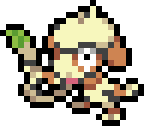
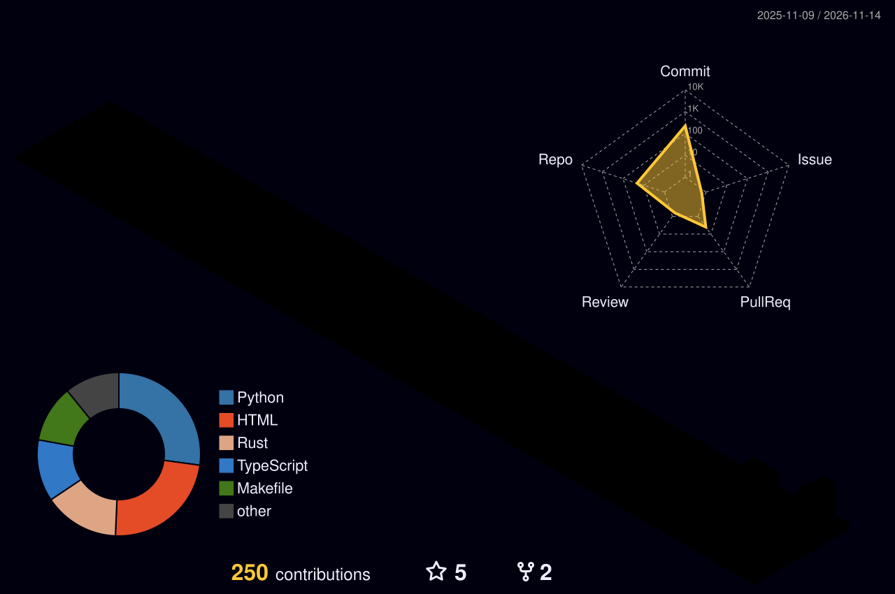
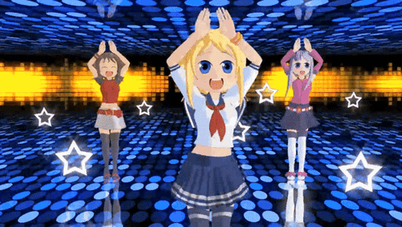

<a id="top"></a>

<p align="center">
  
</p>

<p align="center">
  
</p>


<p align="center"><i>Alien yet familiar</i></p>

<p align="center">
  
  
  
</p>

<p align="center">
  <a href="https://github.com/tahaenasraoui-debug"></a>
  <a href="mailto:tahaenasraoui@gmail.com"></a>
  

<p align="center">
  
</p>


<table>
  <tr>
    <td align="center" valign="middle">
      
    </td>
    <td valign="middle">

```text
tahary@fsr-rabat
-----------------
Pokemon  : Smeargle #235
Category : Painter Pokemon
Type     : Normal
Ability  : Own Tempo
Move     : Sketch
OS       : Linux
Uni      : FSR Rabat, Math-Info
Focus    : AI/ML + low-level systems
Langs    : Python, Bash, AutoHotkey
```

</td>
</tr>
</table>


<p align="center">
  
</p>

## 【 Skills 】

| **Languages** | **Tools** | **Working toward** |
| :---: | :---: | :---: |
|  |  |  |
|  |  |  |
|  |  |  |
|  |  |  |

<p align="center">
  
</p>

## 【 Projects 】

| Project | What it is |
| --- | --- |
| [Open-source-book-downloader](https://github.com/tahaenasraoui-debug/Open-source-book-downloader) | Desktop GUI (Python, Tkinter) that searches Project Gutenberg, Open Library and Google Books and downloads free, public-domain books. Borrow-only and DRM-restricted items are detected and skipped, and shadow libraries are not supported. Prefers EPUB, then PDF, TXT and MOBI, and ships as a Windows `.exe` built with PyInstaller. MIT licensed. |
| [NatroMacro (fork)](https://github.com/tahaenasraoui-debug/NatroMacro) | Fork of the Bee Swarm Simulator macro, with tuned gather paths on the `wf-pinetree-tuning` branch. |

## 【 Working toward 】

<table>
  <tr>
    <td width="50%" valign="top">
      <h3>🧬 Deep learning framework from scratch</h3>
      A small autograd engine with hand-written backpropagation, then a NumPy-only neural network trained on MNIST. No PyTorch in the core, with a benchmark against the same model written in PyTorch.
      <br><br>
      
      
    </td>
    <td width="50%" valign="top">
      <h3>🤖 GPT from scratch</h3>
      A byte-pair-encoding tokenizer and a small decoder-only transformer, trained on a text corpus I collect myself. Covers attention, positional encoding, and the training loop, all written by hand.
      <br><br>
      
      
    </td>
  </tr>
  <tr>
    <td width="50%" valign="top">
      <h3>🎮 RL agent that plays retro games</h3>
      A DQN or PPO agent trained to beat a classic game through an emulator, with training curves and replays of the agent improving over time.
      <br><br>
      
      
    </td>
    <td width="50%" valign="top">
      <h3>🕹️ Game Boy emulator</h3>
      Starting with CHIP-8 to learn the fetch-decode-execute loop, then a Game Boy emulator in C or Rust that boots and runs real ROMs. Low-level systems work, which I'm drawn to through retro gaming.
      <br><br>
      
      
    </td>
  </tr>
  <tr>
    <td colspan="2" valign="top">
      <h3>💡 Ray tracer from scratch</h3>
      A path tracer that renders scenes with spheres, reflections, refraction, soft shadows and depth of field, written from first principles with vector math and no graphics library. The output is an image gallery that shows each feature as it gets added.
      <br><br>
      
      
    </td>
  </tr>
</table>


</details>

<p align="center">
  
</p>

## 【 Stats 】

<p align="center">
  
  
</p>

<p align="center">
  
</p>

<p align="center">
  
</p>

## 【 Contributions 】

<p align="center">
  <picture>
    <source media="(prefers-color-scheme: dark)" srcset="https://raw.githubusercontent.com/tahaenasraoui-debug/tahaenasraoui-debug/output/github-snake-dark.svg" />
    <source media="(prefers-color-scheme: light)" srcset="https://raw.githubusercontent.com/tahaenasraoui-debug/tahaenasraoui-debug/output/github-snake.svg" />
    
  </picture>
</p>

<p align="center">
  
</p>

## 【 Contact 】

<p>
  <a href="https://github.com/tahaenasraoui-debug"></a>
  <a href="mailto:tahaenasraoui@gmail.com"></a>
</p>

<p align="center">
  <a href="#top"></a>
</p>


## 【 Bonus 】

<p align="center">
  
</p>

<p align="center">
  
</p>

<p align="center">
  
</p>
